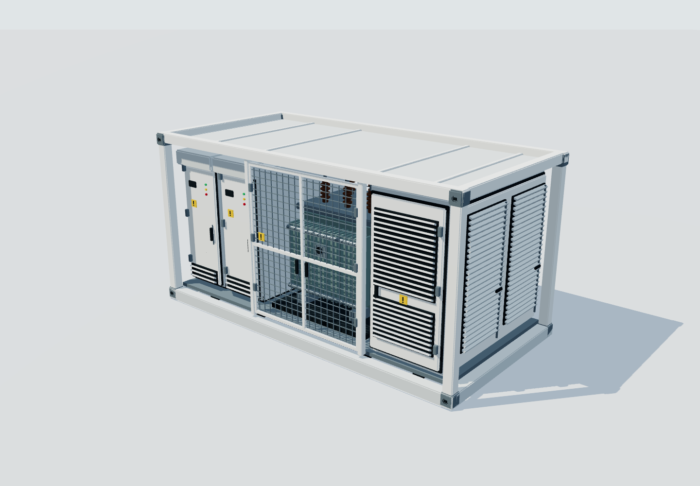

# PCS/MV v2：本地候选与 CC 复审交接

**状态：未提交、未 push、未开 PR、未部署，待用户安排 CC 复审。**
基线 `c10efb04673041822edbb1547e7e31c2b4ae5623`；PR #25 的批准和流水线不覆盖这次工作树。
用户肯定了旧版总体外观、窗口、点击与能流，但明确未仔细检查数字和功能；不扩大为全面验收。

## 改了什么

现有 v1 的 PCS 主要是前后薄门板；中央虽有变压器，网格后面却有整片不透光面板。
因此不是单纯提亮颜色，而是重新构建可独立复用的 generic GLB：

- 左侧两组完整柜身，前后维护门、进风口、顶部罩、控制灯、门锁和铰链。
- 中部真正的几何网罩，后面可见油箱、散热片、支座、端子/绝缘子、线缆和接液盘。
- 右侧完整开关柜舱，正反面及端面的斜百叶门、锁杆；闭合屋顶和结构底架。
- 新增 `scripts/build_generic_pcs_mv_skid.py`，不读取私有源文件、不导入 Switchyard、不联网、不渲染。
- v1 从 public 退役（Git 历史保留），配置改用 v2 URL，避免旧模型缓存沿用。
- 场景主光增加 0.035m `shadow.normalBias`，消除实测柜门/屋顶自阴影条纹；没有修改光照强度/颜色或缓存 GLB 材质。

其余运行代码不变：共同 equipmentScale=0.9、设备位置/承台、相机/点击、七路能流、站级等效容量及调度/PCC/金额计算。

## 参考与复用边界

外观主要参考用户提供的照片，并核对 [Sinexcel 20ft station](https://en.sinexcel.com/energy-storage/details.html?id=26)
与 [Power Electronics MV Skid Compact](https://power-electronics.com/en/storage/mv-skid-compact) 的公开分舱/尺寸信息。
未复制 logo、照片纹理或供应商 CAD；没有把参考设备铭牌套到本项目。
**6×3×3m、5MW/33kV 是沿用的演示约定，不是指定厂商 SKU、BOM、净距或认证承诺。**
已知品牌 token 守护不是知识产权清关；如对外作为工程/商业资产交付，仍需相应审核。

可重建命令与资产来源统一见 [模型说明](../../../public/models/README.md)。
GLB 是 Y-up、米制、centre-ground、单内嵌 buffer、无图像纹理/解码器；9 个材质。
在 Blender 5.1.2 向临时路径第二次导出，和交付文件逐字节一致。

| 指标 | v1 | v2 |
| --- | ---: | ---: |
| 文件 bytes | 1,253,268 | 1,010,176 |
| 三角面 | 24,536 | 21,804 |
| mesh/material batches | 7 | 26 |
| 实测包络 W×H×D (m) | 6.10×3.00×3.114 | 6.00×3.00×3.028 |

GLB SHA256：`63885292c25b6f130d3b0971063c6d0b7de82e9b60afd55797ccd9b751ed98ef`。
文件小约19%、面数少约11%，但 batch/draw submission 增加，**没有 FPS 提升结论**。
本轮 Switchyard 保持只读，HEAD `fd28b09c112cd9f1b11b01285c24755d56b26e22`；
HEAD/status/源脚本/原 GLB 已做前后核对。反向集成尚未实施，需用户另行授权及上游契约检查。

## 验证

- Node24.21.0：307 tests / 25 files、lint、type-check 与 Pages 子路径构建通过。
- 新增5个真实 GLB 用例：两侧网罩射线命中内部设备；两台柜的中深度确有实体；包络/地锚/透明材质/面数/mesh/文件预算。
- 原有三设备共同缩放、承台适配、互不重叠、场景边界测试继续通过；品牌/无纹理契约扩展，BESS/主变二进制不变。
- `asset-preview.mjs` 同灯光比较 v1/v2 前、后、暗光三个视角；输出包络、主渲染 pass calls 和 triangles（后两者含地面，不等于帧总 GPU 成本）。
- `browser-check.mjs` 在生产 Pages 子路径通过：三个设备标签 hover/click、站级等效说明、平移/缩放/Full site、桌面双抽屉、真实 RAF 至13:07/21:07；三 GLB 均HTTP200，零pageerror。640×480 下 HUD底78、卡片顶86/底217.1875px。
- [应用结果](results.json)与[几何预览结果](asset-preview-results.json)保留原始数据；[独立模型预览](after-front.png)、[实际应用近景](pcs-closeup.png)、[实际夜景](night-overview.png)用于对照。现有夜景整体偏暗，内部细节可读性仍是开放视觉项，不因脚本通过就标为完美。
- Blender 首次沙箱启动在 Metal capability detection 崩溃，Python 尚未执行；沙箱外后台导出正常退出0，无 GPU 渲染。Blender6 的 use_nodes 弃用提示和既有 Three 大 chunk 提示非失败。

浏览器脚本调用示例（使用外置 Playwright，未新增项目依赖）：

```bash
PLAYWRIGHT_MODULE=/absolute/path/to/playwright node docs/audits/2026-10-23/asset-preview.mjs http://127.0.0.1:5173
PLAYWRIGHT_MODULE=/absolute/path/to/playwright node docs/audits/2026-10-23/browser-check.mjs http://127.0.0.1:4173/BESS-Storage-Simulator/
```

两脚本均为 Chromium/SwiftShader，不是原生 GPU/真机触摸验收。独立预览灯光与应用不同，不能拿它替代实际场景验证。
脚本调试阶段纠正了旧标题/已卸载 drawer trigger 的错误断言；最终用实际 region 状态验双开。正式结果来自固定生产构建，避免开发中删除旧资产触发 HMR 干扰测试。
不自动调用 CC 或其他外部模型；本轮未重跑 audit、未更改任何依赖，不将旧零公告结论更新为今天。

## 文档 Housekeeping

repo README/CLAUDE/文档索引删除重复发布叙述，仅指向已冻结的发布证据与本候选。
模型说明集中保留来源、重建命令、体积/面数及复用边界。旧审计页和截图未修改。

Vault 仅更新 `Gotion/平台开发/BESS Storage Simulator/` 的 README、概览、操作指南、路线图、迭代记录五篇：
路线图不再复制完成批次，操作指南两处“本地候选”改为 PR #25 已发布，当前模型候选与已部署基线分开。
保留身份 frontmatter/aliases/tags；完整 dated history 字节不变，全部历史 hash/run ID 仍可检索。
29 个无关脏文件前后哈希不变。没有强行压缩历史；加入本轮证据后五篇总量略增，不宣称整体减重。

## 建议 CC 重点复审

1. 生成脚本与实际 GLB 是否一致；网罩不藏背板、实体柜身与连线是否视觉自洽，是否保持通用非厂商模型口径。
2. 26 批次相对旧7批次的取舍；细网格远景闪烁、昼夜可读性、normalBias 是否导致接触阴影浮离，需要原生 GPU 肉眼检查。
3. BASE_URL、模型缓存/重试/占位和标签/body raycast 是否回归；完整容量等效含义是否保留。
4. 五篇 Vault 的历史完整性、候选/发布/用户观感反馈的区分；不要将旧 CC 批准视为本次批准。

用户通过后再决定 commit/PR 与 Switchyard 回流；这两步均未执行。


