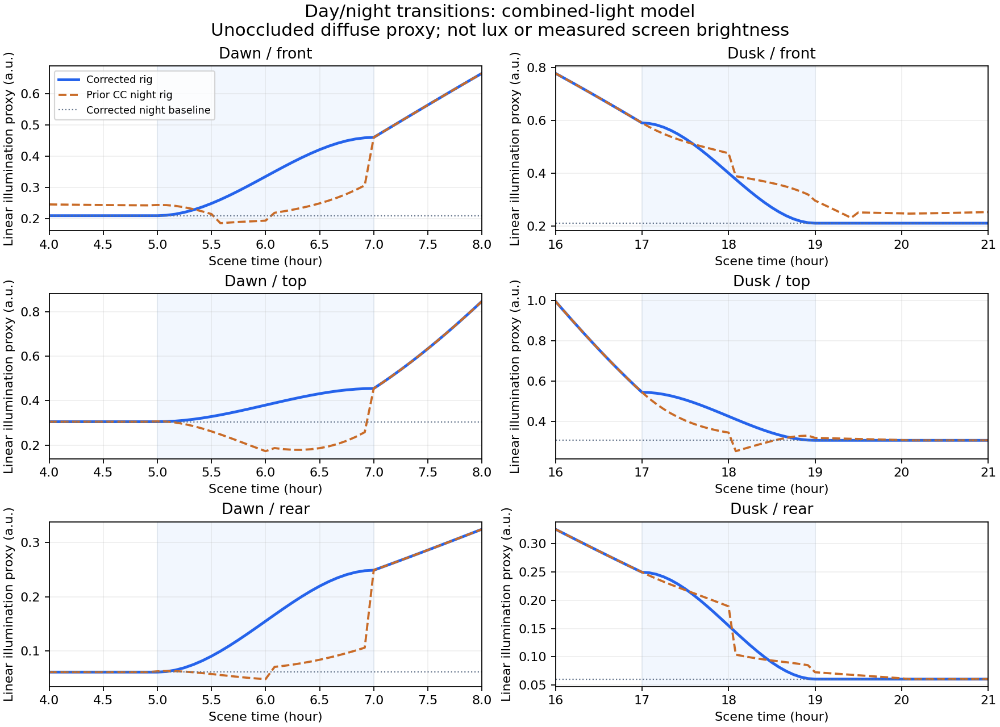

# 日夜照明与天空连续性：本地候选

**2026-10-24：用户同意保留阴影警告修复、夜间补光，并要求修复天空及清晨/黄昏过渡。尚未 commit、push、开 PR 或部署，待用户另行安排 CC 复审。**

基线 HEAD 仍为 `c10efb04673041822edbb1547e7e31c2b4ae5623`。本页是叠加在未提交 PCS/MV v2 上的独立照明记录；[v2 收口记录](../2026-10-24/README.md)及此前截图、318/25 检查结果保持原字节。不能把旧 CC 通过结论扩大到本轮代码。Codex 未调用 CC 或其他外部审查服务。

## 来源与发现

用户转交的 CC 报告提出两项本地修改：`Canvas shadows="percentage"`，以及用不投影的月光方向光替换微弱点光源、提高夜间半球光。Codex 独立重跑原候选得到 Node 24.21.0 下 322/26、lint、类型检查和 Pages 构建通过。

阴影修正与本地锁定源码一致：R3F 9.5.0 的布尔 shadows 使用 PCFSoft；three 0.183.2 会警告并改成 PCF，显式 percentage 直接选用 PCF。原报告的 3126 条日志属于 CC 提供的历史计数，本轮不声称重新复现该计数。[上游 r183 源码](https://github.com/mrdoob/three.js/blob/r183/src/renderers/webgl/WebGLShadowMap.js)

原报告“黄昏凹陷已经消除”不能成立。按其最终参数重算，顶面代理值在 18:15 为 0.272325，18:45 为 0.323141，深夜为 0.305216。更密采样显示 18:00:03 附近为 0.241348，比深夜低约 20.93%。这是天空跳变和分别淡入淡出的光源相互作用；天空、ambient、sun 的分段跳变早于 CC 补光修改。

## 本轮实现

- 保留显式 PCF、月光位置/颜色/0.5 强度、夜间半球光 0.7 的设置；不改材质、模型、仿真引擎或依赖。
- `sceneLighting.ts` 统一天空/雾色与四盏灯的显示参数，5–7h、17–19h 用同一 smoothstep 混合完整照明。颜色采用**线性 RGB × 光强**加权后还原，而非颜色和光强各自混合再相乘。
- 过渡期将白天太阳位置固定在 7h/17h 的端点，避免太阳先落下、月光尚未补足造成顶面变暗；7–17h 保留原白天输入。夜间太阳强度为零，消除原来从地平线下方打来的 0.1 太阳光。
- 每个场景复用独立输出对象、颜色及坐标数组，在同一 `useFrame` 更新所有动态光源参数。相同属性不再由 JSX 和帧循环同时写入。
- 这是演示用照明设计，不是天文太阳轨迹、实际照度或 PV 发电模型。7/17h 的数值连续，但未宣称整个函数一阶导数连续。

## 数学与自动测试

Node **24.21.0**：**340 tests / 26 files**、lint、类型检查和 `BASE_URL=/BESS-Storage-Simulator/` 构建通过。照明测试从 4 项增至 22 项，覆盖白天保持、所有旧分段边界、午夜、完整光照的单调性/端点范围及可复用对象隔离。构建仍有既有的 Three 大包提示。

最终命令输出：[测试](test-output.txt)、[lint](lint-output.txt)、[类型检查与构建](build-output.txt)。文档更新后再构建的 14 个生产文件与浏览器验收版本逐字节一致。

[独立曲线脚本](lighting-curve-check.mjs)通过 esbuild 在内存中导入**实际 helper**；旧 CC 公式独立冻结作比较，不复制新公式作为验收依据。[原始结果](curve-results.json)记录版本、源码 SHA256、全部阈值及限制；[5 分钟 CSV](curve.csv)便于重算。

- 全天每 3 秒采样，共 28,801 点，全部有限且非负；夜间有效光照无漂移。
- 两个过渡窗口各 2,401 点：六个轴向面的亮度代理值无反向变化，也不低于夜间端点。
- 264 个倾斜法线无端点越界；其昼夜端点可能高低相反，不声称任意表面都随天亮变亮。
- 7–17h 与原白天参数最大数值差 `1.03e-13`；端点混合最大残差约 `3.00e-15`，均为浮点误差量级。
- 边界检查覆盖 0、5、5.5、6、7、12、17、18、19、19.5、20、24h。午夜零强度太阳的位置不参与可见光照连续性判断。

| 代表面 | 修正后夜间/正午代理比 |
| --- | ---: |
| 正面 | 17.05% |
| 顶面 | 12.77% |
| 背面 | 10.19% |

原报告正面约 24% 包含地下太阳贡献，本轮取消该贡献后变为约 17%。这些是无阴影漫反射线性亮度代理，**不是 lux、截图实测亮度或设备可读性保证**；不包括材质 BRDF、遮挡、阴影、雾及色调映射。



## 浏览器证据

在实际 Pages 子路径生产构建上使用 Node 24.21.0、Playwright 1.61.1、Chromium 149.0.7827.55 / **SwiftShader 软件 WebGL**，1440×1000、DPR 1。没有改写 bundle 或网络响应，也没有新增生产测试接口。

[受控检查脚本](lighting-browser-check.mjs)临时通过 React DevTools/Fiber 取得场景并只改变停止状态下的时间，固定相机和其他仿真数据；[结果](browser/results.json)保存实际光源、雾色、相机、GL 模式及日志。18 张主截图加 14 张边界截图，11 组边界前后各 1 秒的实际光源/雾色通道差均通过，最大值约 `0.00044336`，午夜为零。三个 GLB 均为 Pages 路径 HTTP 200；无页面异常、shader 错误、阴影弃用警告或失败请求。保留已知 `THREE.Clock` 弃用提示和 SwiftShader 截图读回提示。

受控时间截图故意保留初始白天 PV 遥测，夜里黄色光伏并非自然夜间运行，不能据此验收光伏夜景。部分软件截图遗漏 HUD 合成内容，不作为 HUD 验收证据。核查了设备正面、背面、顶面/网罩及 6h、18h 边界对照，未见对应的照明/雾色跳变。

- [6h 清晨](browser/front-06-00.png)、[18:15 黄昏](browser/front-18-15.png)
- [夜间设备正面](browser/pcs-front-23-00.png)、[夜间设备背面](browser/pcs-rear-23-00.png)
- [18h 前](browser/boundary-18-before.png)、[18h 后](browser/boundary-18-after.png)

另复用冻结的 [真实应用 smoke 脚本](../2026-10-23/browser-check.mjs)，通过实际 RAF 运行至 **13:07 / 21:07**，而非注入时间；[结果](live-smoke/results.json)和[真实夜景](live-smoke/night-overview.png)显示夜间 PV 为 0 MW，设备仍可辨、光伏阵列仍偏暗。三台设备 hover/click、站级说明、平移缩放/Full site、双抽屉通过；640×480 下 HUD 底 78px、卡片顶 86px，间距 8px。

这些是模型与软件渲染检查；**本轮没有完成原生 GPU 连续转动/远景网格闪烁或实体手机验收**。不将离散截图写成连续动作无闪烁的证明。

## 复现与复审重点

```bash
# 使用 .nvmrc 指定的 Node 24.21.0；依赖已按 lockfile 安装
npm test
npm run lint
BASE_URL=/BESS-Storage-Simulator/ npm run build
node docs/audits/2026-10-24-lighting/lighting-curve-check.mjs
python3 docs/audits/2026-10-24-lighting/plot-curves.py  # 可选，需要 matplotlib
BASE_URL=/BESS-Storage-Simulator/ npm run preview -- --host 127.0.0.1 --port 4173 --strictPort
# Playwright 是外部审计运行时，未新增为项目依赖
PLAYWRIGHT_MODULE=/absolute/path/to/playwright node docs/audits/2026-10-24-lighting/lighting-browser-check.mjs http://127.0.0.1:4173/BESS-Storage-Simulator/ /tmp/bess-lighting-browser
PLAYWRIGHT_MODULE=/absolute/path/to/playwright node docs/audits/2026-10-23/browser-check.mjs http://127.0.0.1:4173/BESS-Storage-Simulator/ /tmp/bess-lighting-live
```

用户安排 CC 后重点复核：辐射量加权是否正确、过渡期固定太阳方向是否可接受、测试是否能拒绝旧跳变/凹陷、原生 GPU 清晨/黄昏与夜间正反面，以及连续旋转的远景网格。PV 夜间材质/环境反射、R3F 内部 Clock 升级与实体手机仍单独待办，不混入此次修复。

此前 v2 GLB SHA256 仍为 `3fd747a9e03d0df819b685b9c0bb49b6e38b7cbe898d295dc5860f10836e0a5c`；模型及生成脚本不变。旧 10-23/10-24 审计、截图和 v2 证据保持原字节。Vault 仅更新 BESS 的 README、概览、操作指南、路线图、迭代记录五篇，保留旧验收时点和历史正文。最终变更范围与保护检查见 [scope-check.json](scope-check.json)。

全 Vault 前后哈希覆盖 2,567 个常规文件（排除 `.git`）。除上述五篇外，检测到两篇 Switchyard 笔记在任务期间发生并行变化；本轮写入脚本不包含它们，未覆盖或回退。其余非目标文件和现有附件保持基线哈希，未新增或删除 Vault 文件。该差异单独记录，不将其他工作的变化归入本轮。
